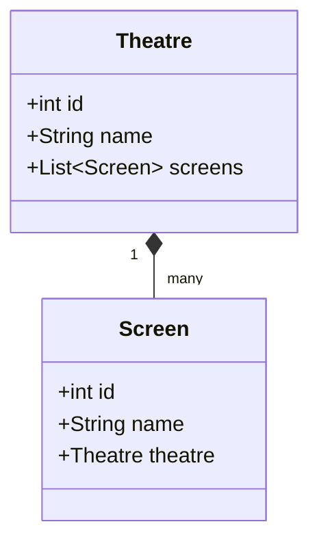
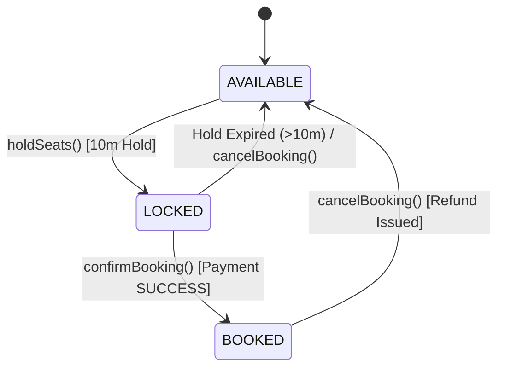
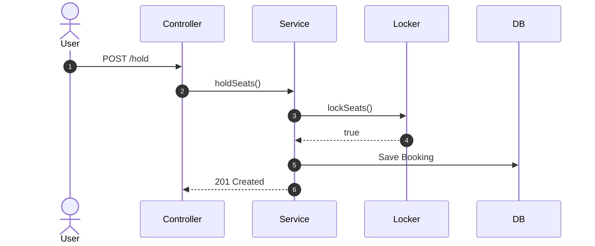

# Low-Level Design (LLD) Architect Skill

Use this skill whenever authoring, structuring, or reviewing a **Low-Level Design (LLD)** document or project `README.md` across the repository (e.g. `book-my-show-design`, `search-auto-complete`, `parking-spot-lld`, `cache-lld`, `bloom-filter-design`, `task-management-system`).

This skill standardizes the structure so you **never have to search around previous examples** to remember headers, metadata tags, Mermaid conventions, or theme-aware SVG picture tags.

---

## 1. Mandatory Metadata Standards (Enforced by `npm test`)

Every LLD project `README.md` **MUST** begin with the invisible HTML comment block `<!-- hub-metadata -->`. The monorepo automated test suite (`tests/metadata-linter.test.mjs`) and GitOps discovery engine (`scripts/auto-discover-content.mjs`) validate this schema on every test run.

```markdown
<!-- hub-metadata
type: lld
title: "Project Name (e.g. BookMyShow Cinema Ticketing Engine)"
description: "Concise 1-2 sentence description explaining the core architecture, concurrency, and patterns."
tag: "Low-Level Design"
tagColor: "#f97316"
difficulty: "Medium" | "Hard"
publishedAt: "YYYY-MM-DD"
language: "Java 21 / Spring Boot"
designPatterns: ["Strategy Pattern", "State Pattern", "Canonical Lock Ordering", "Repository Pattern", "Builder Pattern"]
githubRepo: "https://github.com/JyotimoyKashyap/system-design-labs/tree/main/<folder-name>"
-->
```

> [!IMPORTANT]
> The `type: lld` line tells the GitOps engine to automatically publish this document to `/lld/<slug>` with zero manual routing configuration.

---

## 2. Canonical 8-Section LLD Blueprint

Every production-grade LLD document must follow this exact 8-section progression:

```
1. Problem Statement & Core Challenges
2. Requirements & Scope Boundaries (PR, FR, NFR)
3. Domain Modeling & Architecture (Mermaid classDiagram + Design Rationale)
4. State Machine & Sequence Flows (Mermaid stateDiagram-v2 + sequenceDiagram)
5. Core Engine & Concurrency Deep-Dive (Algorithms, Mutexes, Lock Ordering)
6. Visual Architecture Diagrams (Theme-Aware Excalidraw <picture> tag)
7. REST API / Programmatic Interface Specification
8. Concurrency Verification & Test Results
```

---

### Section 1: Problem Statement & Core Challenges
Hook the reader with the real-world scale and failure modes:
1. **Real-World Context**: Why is this problem hard? (e.g., "When Avengers tickets drop, 50,000 users race for the same 4 recliner seats at the exact same millisecond.")
2. **The 4 Fundamental Engineering Challenges**:
   - **Concurrency & Race Conditions**: How to achieve zero double-allocation/double-booking.
   - **Deadlock Avoidance**: How multi-item reservations avoid circular-wait freezes.
   - **Latency & Throughput**: Sub-10ms read lookups without database bottlenecks.
   - **Resource Optimization**: Why lazy on-demand evaluation beats heavy background database sweepers.

---

### Section 2: Requirements & Scope Boundaries
Break down requirements with unambiguous rigor:
* **2.1 Product Requirements (PR)**: User-facing capabilities (e.g. PR-1: Seat Selection, PR-2: 10-Minute Checkout Hold, PR-3: Instant Cancellation).
* **2.2 Functional Requirements (FR)**: Precise method contracts with explicit return types and arguments:
  ```java
  Booking holdSeats(int showId, List<Integer> seatIds, int userId);
  ```
  > **Design Decision Callouts**: Always document the *why* in blockquotes (e.g., why returning `List<String>` is superior to `Optional<List<String>>`, or why returning an explicit `Booking` entity provides transaction transparency).
* **2.3 Non-Functional Requirements (NFR)**:
  - **Thread-Safety**: Concurrency guarantees under $N$ simultaneous threads.
  - **Bounded Memory**: Heap limits and memory footprint guarantees.
  - **Extensibility**: Open-Closed Principle adherence (adding new types without altering core engines).

---

### Section 3: Domain Modeling & Architecture

#### 3.1 Mermaid Class Diagram
Always include a rich, syntactically valid Mermaid `classDiagram`:
- Use `<|--` for inheritance.
- Use `*--` for composition (owns lifecycle).
- Use `o--` for aggregation (references collection).
- Use `-->` for associations.



#### 3.2 Key Architectural Design Decisions
Detail non-obvious entity decisions:
1. **Spatial vs. Contextual Entity Separation**: e.g., `Seat` (spatial coordinate screwed into the auditorium floor) vs. `ShowSeat` (contextual state for a specific show with price and status).
2. **Polymorphic Taxonomy**: e.g., `@Inheritance(strategy = InheritanceType.SINGLE_TABLE)` for `SeatType` (`StandardSeatType`, `PremiumSeatType`, `ReclinerSeatType`) vs. static enums.

---

### Section 4: State Machine & Sequence Flows

#### 4.1 State Machine (`stateDiagram-v2`)
Capture all entity state transitions, including rollbacks and expirations:



#### 4.2 Sequence Flow (`sequenceDiagram`)
Trace interaction across Client, Controller, Service, Concurrency Engine, Database, and External Services (Payment/Gateways):



---

### Section 5: Core Engine & Concurrency Deep-Dive
This is the technical heart of the LLD. Explain:
1. **Canonical Key Ordering & Deadlock Prevention Proof**:
   - Explain how sorting keys monotonically (`seatIds.stream().sorted()`) breaks the **Coffman Circular Wait condition**.
   - Show why Thread A requesting `[1, 2]` and Thread B requesting `[2, 1]` will both acquire in `1 -> 2` order, eliminating deadlocks.
2. **All-or-Nothing Atomic Multi-Lock Acquisition**:
   - Phase 1: `tryLock()` on all item locks.
   - Phase 2: Validate existing locks & TTL freshness.
   - Phase 3: Commit state to `ConcurrentHashMap` / Redis.
   - Phase 4: Release mutexes in `finally`.
3. **On-Demand Lazy Expiration (Zero-Cron Optimization)**:
   - Why lazy expiration via `ConcurrentHashMap.entrySet().removeIf(...)` or on-access TTL checks outperforms polling database sweepers.

---

### Section 6: Visual Architecture & Excalidraw Diagrams

When embedding custom SVG diagrams created in Excalidraw, **ALWAYS** use the theme-aware `<picture>` tag pattern.

Store assets in `<project-folder>/assets/`:
- `<diagram-name>-dark.svg`
- `<diagram-name>-light.svg`

#### Canonical Theme-Aware Embedding:
```html
<picture>
  <source media="(prefers-color-scheme: dark)" srcset="./assets/<diagram-name>-dark.svg">
  <source media="(prefers-color-scheme: light)" srcset="./assets/<diagram-name>-light.svg">
  -light.svg" width="100%">
</picture>
```

> [!NOTE]
> The auto-discovery pipeline (`scripts/auto-discover-content.mjs`) automatically scans `srcset="./assets/..."` and rewrites it to GitHub raw CDN URLs for the Astro web app while keeping local relative paths intact for GitHub/IDE viewing.

---

### Section 7: REST API Specification
Provide a clean summary table of endpoints followed by request/response JSON contracts:

| Method | Endpoint | Description | Success Code | Error Codes |
| :--- | :--- | :--- | :--- | :--- |
| `POST` | `/api/v1/bookings/hold` | Phase 1: 10-minute seat hold | `201 Created` | `409 Conflict`, `400 Bad Request` |
| `POST` | `/api/v1/bookings/{id}/confirm` | Phase 2: Payment confirmation | `200 OK` | `410 Gone`, `400 Bad Request` |
| `POST` | `/api/v1/bookings/{id}/cancel` | Cancel & issue refund | `200 OK` | `400 Bad Request` |
| `GET` | `/api/v1/shows/{id}/seats` | Real-time seat layout | `200 OK` | `404 Not Found` |

Always include representative JSON request and response payloads, especially HTTP 409 Conflict error payloads.

---

### Section 8: Concurrency Verification & Test Results
Document the multi-threaded test suite that proves correctness:
- **Test Harness**: JUnit 5 + `ExecutorService` + `CountDownLatch` (simultaneous race condition simulation).
- **Test Scenarios**:
  1. *Identical Item Contention*: $N$ concurrent threads racing for the exact same item &rarr; Exactly 1 wins, $N-1$ fail fast.
  2. *Disjoint Allocation*: $M$ concurrent threads requesting non-overlapping items &rarr; All $M$ succeed simultaneously.
  3. *Deadlock Proof*: Opposite lock orders &rarr; Complete in milliseconds with zero thread hangs.
- **Evolutionary Roadmap Table**: Compare Phase 1 (Single-Node In-Memory) vs. Phase 2 (Distributed Redis / Postgres).

---

## 3. Strict Quality Guardrails

1. **Strict Content Isolation**: LLD files must link only back to `/lld` ("Back to All LLD"). Never inject cross-linking banners to `/notes` or `/labs`.
2. **No Serif Fonts & No Rounded Corners**: All styling complies with the Paper Brutalist Design System.
3. **KaTeX Math Formatting**:
   - Use KaTeX inline math: `$O(1)$` or `$O(N \log N)$`.
   - Never leave unescaped naked `$` in text (write `\$100` or backticks).
4. **Verification**: Always execute `npm test` after modifying any LLD README or document to ensure all 35+ test suite checks pass cleanly.

