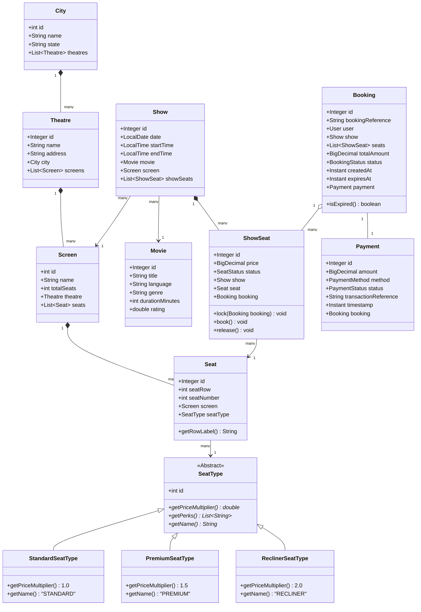
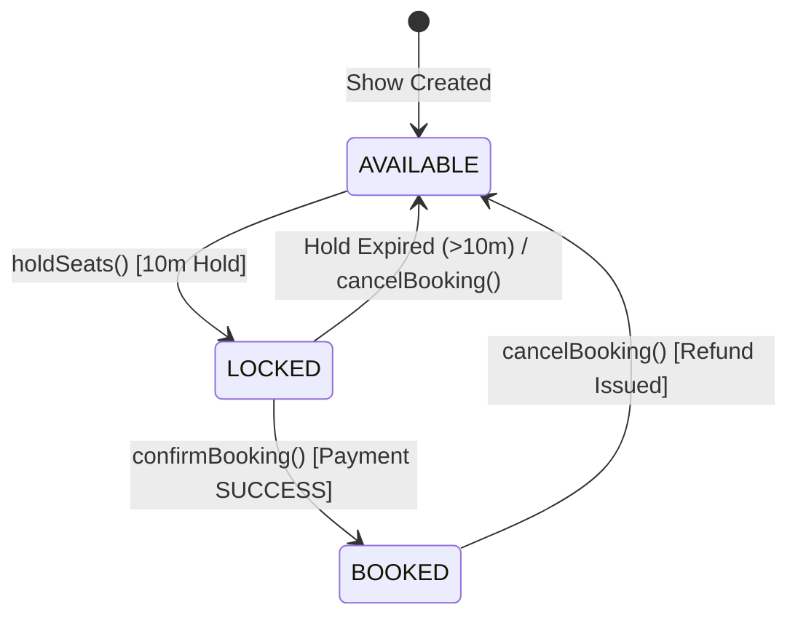
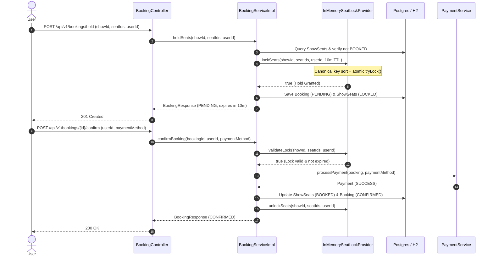

# BookMyShow Cinema Ticketing Engine — Low-Level Design

## 1. Problem Statement

When blockbuster movies like *Avengers: Endgame* or *Interstellar* open for advance ticket booking, cinema platforms experience extreme traffic surges. Tens of thousands of users attempt to select, hold, and purchase the exact same premier seats within the same fraction of a second.

Building an enterprise-grade **Cinema Ticket Reservation System (BookMyShow)** requires solving four fundamental low-level engineering challenges:

1. **Zero Double-Booking Guarantee:** Under no circumstances may two concurrent users book the same seat for the same show. Exactly one transaction must succeed; all other concurrent attempts must be safely rejected.
2. **Deadlock-Free Batch Locking:** Users frequently book multiple seats at once (e.g., a family booking seats 12, 13, and 14). If User A locks `[12, 13]` while User B locks `[13, 12]`, naive locking causes a circular wait deadlock that freezes worker threads.
3. **Two-Phase Reservation with TTL Expiry:** Booking cannot immediately charge a card while holding seats indefinitely. The platform must grant a temporary hold (e.g., 10 minutes) for checkout, and release the hold if payment is abandoned.
4. **On-Demand Real-Time Availability (Zero-Sweeper Overhead):** The platform cannot afford background jobs constantly scanning and executing `UPDATE show_seats SET status='AVAILABLE'` across millions of database rows every second. Availability evaluation must be lightweight, lazy, and overlaid on the fly.

---

## 2. Requirements & Scope Boundaries

### 2.1 Product Requirements

* **PR-1 (City & Movie Browsing):** Users can discover which movies are running in their selected city, and view theatres, auditoriums (screens), and show timings.
* **PR-2 (Interactive Seating Grid):** Users can inspect an auditorium's seating map, observing which seats are permanently `BOOKED`, currently `LOCKED` by another user, or freely `AVAILABLE`.
* **PR-3 (Two-Phase Checkout):**
  - **Phase 1 (Hold):** A user selects up to $N$ seats. The system grants a temporary 10-minute hold and generates a `PENDING` booking reference.
  - **Phase 2 (Confirm):** The user submits payment. Once the payment gateway succeeds, seats transition to permanently `BOOKED` and the ticket is confirmed.
* **PR-4 (Cancellation & Refund):** A user can cancel a confirmed booking, refunding the transaction and immediately returning seats to `AVAILABLE`.

### 2.2 Functional Requirements

#### FR-1: Core Service Contracts

* **Hold Seats (Phase 1):**
  ```java
  Booking holdSeats(int showId, List<Integer> seatIds, int userId);
  ```
  Acquires an atomic, all-or-nothing lock on the requested seats for 10 minutes. Returns a `PENDING` booking. Throws `SeatUnavailableException` if any seat is already booked or actively locked.

* **Confirm Booking (Phase 2):**
  ```java
  Booking confirmBooking(int bookingId, int userId, PaymentMethod paymentMethod);
  ```
  Validates ownership and TTL freshness of the held lock, processes payment, transitions seats to `BOOKED`, clears the temporary hold, and marks the booking `CONFIRMED`.

* **Cancel Booking:**
  ```java
  Booking cancelBooking(int bookingId, int userId);
  ```
  Refunds payment, transitions seats back to `AVAILABLE`, and marks booking `CANCELLED`.

* **Real-time Seating Map:**
  ```java
  List<ShowSeat> getSeatLayout(int showId);
  ```
  Returns the complete seat grid, dynamically overlaying active in-memory locks over persisted database records.

---

## 3. Domain Modeling & Architecture

### 3.1 Class Diagram



---

### 3.2 Key Architectural Design Decisions

#### 1. Separation of `Seat` vs. `ShowSeat`
* **`Seat` (Spatial & Immutable):** Represents the physical chair screwed into the floor of an auditorium (`row = 0`, `number = 5`, `type = RECLINER`). It has no notion of price, booking status, or movie.
* **`ShowSeat` (Contextual & Mutable):** Represents the right to sit in a specific `Seat` for a specific `Show`. It holds the runtime state (`status = AVAILABLE | LOCKED | BOOKED`), the calculated show-specific price, and the associated `Booking`.
* **Why this matters:** Multiple shows running in the same screen share identical physical `Seat` definitions without data redundancy or cross-show lock collisions.

#### 2. Polymorphic `SeatType` with Single-Table Inheritance
* Rather than maintaining hardcoded seat strings or static enums, `SeatType` is modeled as an extensible entity using `@Inheritance(strategy = InheritanceType.SINGLE_TABLE)`:
  - `StandardSeatType`: Multiplier `1.0x`
  - `PremiumSeatType`: Multiplier `1.5x`, includes USB charging and extra legroom perks
  - `ReclinerSeatType`: Multiplier `2.0x`, includes 160° recline and complimentary popcorn
* This allows cinema chains to introduce VIP, IMAX Laser, or 4DX seat tiers with custom price multipliers and perks without altering database schemas.

---

## 4. Two-Phase Reservation State Machine

Seat reservations follow a strict two-phase commit lifecycle to avoid holding inventory permanently for abandoned shopping carts:



### Sequence Flow: Hold & Confirm



---

## 5. The Concurrency Engine (`InMemorySeatLockProvider`)

<picture>
  <source media="(prefers-color-scheme: dark)" srcset="https://raw.githubusercontent.com/JyotimoyKashyap/system-design-labs/main/book-my-show-design/assets/seat-locking-dark.svg">
  <source media="(prefers-color-scheme: light)" srcset="https://raw.githubusercontent.com/JyotimoyKashyap/system-design-labs/main/book-my-show-design/assets/seat-locking-light.svg">
  
</picture>

The core concurrency coordination happens inside [`InMemorySeatLockProvider`](file:///Users/jyotimoykashyap/Developer/personal-lab/book-my-show-design/src/main/java/com/jyotimoykashyap/bookmyshowdesign/locker/InMemorySeatLockProvider.java).

```
[ Request: Hold Seats {12, 5} for Show 1 ]
                   │
                   ▼
       1. Canonical Key Sorting
         [ (1, 5), (1, 12) ]
                   │
                   ▼
       2. Multi-Lock Acquisition
    seatLocks.get((1,5)).tryLock()   ──► [Acquired]
    seatLocks.get((1,12)).tryLock()  ──► [Acquired]
                   │
                   ▼
       3. All-or-Nothing Freshness Validation
    locks.get((1,5))  == null || expired?  ──► Yes
    locks.get((1,12)) == null || expired?  ──► Yes
                   │
                   ▼
       4. Commit Locks into ConcurrentHashMap
    locks.put((1,5),  SeatLock[userId=42, ttl=10m])
    locks.put((1,12), SeatLock[userId=42, ttl=10m])
                   │
                   ▼
       5. Release ReentrantLocks
```

### 5.1 Canonical Key Ordering (Deadlock Prevention Proof)

#### The Problem: Circular Wait Deadlock
Suppose User A attempts to reserve `[Seat 5, Seat 12]`, while User B simultaneously attempts to reserve `[Seat 12, Seat 5]`:
- Thread A acquires Lock for Seat 5, then tries to acquire Lock for Seat 12.
- Thread B acquires Lock for Seat 12, then tries to acquire Lock for Seat 5.
- Both threads block waiting for each other indefinitely &rarr; **Coffman Circular Wait Deadlock**.

#### The Mathematical Solution: Total Global Order
`ShowSeatKey` implements `Comparable<ShowSeatKey>`:
```java
public record ShowSeatKey(int showId, int seatId) implements Comparable<ShowSeatKey> {
    @Override
    public int compareTo(ShowSeatKey other) {
        int showDiff = Integer.compare(this.showId, other.showId);
        return showDiff != 0 ? showDiff : Integer.compare(this.seatId, other.seatId);
    }
}
```

Before acquiring any mutexes, `seatIds` are sorted into a strict canonical sequence:
```java
List<ShowSeatKey> keys = seatIds.stream()
        .sorted()
        .map(seatId -> new ShowSeatKey(showId, seatId))
        .toList();
```
Because all threads acquire locks in the exact same monotonic order (`Seat 5` then `Seat 12`), circular wait is mathematically impossible.

---

### 5.2 All-or-Nothing Batch Acquisition

A major flaw in naive reservation systems is **partial holds**: User requests seats 1, 2, and 3. Seat 1 and 2 succeed, but Seat 3 is taken by someone else. If the system leaves Seat 1 and 2 locked, resources are leaked and the user gets a fractured experience.

In our locker:
1. All mutexes are acquired via non-blocking `seatLock.tryLock()`.
2. If any single mutex is contended, the method aborts immediately, releases all already acquired locks, and returns `false`.
3. It inspects all keys for active non-expired locks. If any single seat is held, it aborts without modifying state.
4. Only when **all** seats are confirmed free does it write the new locks into memory.

---

### 5.3 On-Demand Lazy Expiration (Zero-Cron Optimization)

Rather than running an expensive background sweeper every 5 seconds to purge expired rows from the database:

1. **Lazy Eviction in Memory:**
   When `getLockedSeats(int showId)` is queried, it actively purges stale entries using thread-safe entry-set eviction:
   ```java
   locks.entrySet().removeIf(entry -> 
       entry.getKey().showId() == showId && entry.getValue().isExpired()
   );
   ```
2. **Catalog Overlay (`ShowCatalogServiceImpl`):**
   When `getSeatLayout(showId)` builds the seating map, it checks `SeatStatus.BOOKED` against the database. If a seat is not permanently booked, its status is decided live:
   - In `lockedSeatIds` &rarr; `SeatStatus.LOCKED`
   - Expired or not in `lockedSeatIds` &rarr; `SeatStatus.AVAILABLE`
3. **Lazy DB State Transition (`BookingServiceImpl`):**
   If an expired user calls `confirmBooking()`, the service detects `booking.isExpired()`, updates the database status to `BookingStatus.EXPIRED`, and rejects the checkout.

---

## 6. REST API Specification

### Endpoints Overview

| Method | Endpoint | Description | Success Code | Error Codes |
| :--- | :--- | :--- | :--- | :--- |
| `GET` | `/api/v1/cities/{id}/movies` | List all movies showing in a city | `200 OK` | `404 Not Found` |
| `GET` | `/api/v1/shows` | Query shows by `movieId`, `cityId`, and `date` | `200 OK` | `400 Bad Request` |
| `GET` | `/api/v1/shows/{id}/seats` | Real-time seat layout with lock status | `200 OK` | `404 Not Found` |
| `POST` | `/api/v1/bookings/hold` | Phase 1: Acquire 10-minute hold on seats | `201 Created` | `409 Conflict`, `400 Bad Request` |
| `POST` | `/api/v1/bookings/{id}/confirm`| Phase 2: Process payment & confirm booking | `200 OK` | `410 Gone`, `400 Bad Request` |
| `POST` | `/api/v1/bookings/{id}/cancel` | Cancel booking, refund payment & free seats | `200 OK` | `400 Bad Request` |
| `GET` | `/api/v1/bookings/{ref}` | Retrieve booking by reference number | `200 OK` | `404 Not Found` |

### Sample Payloads

#### 1. Hold Seats Request (`POST /api/v1/bookings/hold`)
```json
{
  "showId": 1,
  "seatIds": [1, 2],
  "userId": 1
}
```

**Response (`201 Created`):**
```json
{
  "id": 1,
  "bookingReference": "BMS-A7B2C9D1",
  "userId": 1,
  "userName": "Alice Smith",
  "showId": 1,
  "movieTitle": "Interstellar",
  "theatreName": "PVR Forum Koramangala",
  "screenName": "Audi 1 (Dolby Atmos)",
  "seatLabels": ["A1", "A2"],
  "totalAmount": 800.00,
  "status": "PENDING",
  "createdAt": "2026-10-16T14:00:00Z",
  "expiresAt": "2026-10-16T14:10:00Z",
  "paymentTransactionReference": null
}
```

#### 2. Conflict Response (`409 Conflict`)
When another user attempts to hold already held or booked seats:
```json
{
  "error": "SEAT_UNAVAILABLE",
  "message": "One or more seats are currently locked by another user",
  "timestamp": "2026-10-16T14:00:01.120Z"
}
```

---

## 7. Concurrency Verification & Test Results

The concurrency guarantees were verified via [`BookingServiceConcurrencyTest`](file:///Users/jyotimoykashyap/Developer/personal-lab/book-my-show-design/src/test/java/com/jyotimoykashyap/bookmyshowdesign/service/BookingServiceConcurrencyTest.java):

```java
@Test
@DisplayName("20 concurrent threads race for the exact same 2 seats -> Exactly 1 wins, 19 fail fast")
void testConcurrentHoldSeats_sameSeats_onlyOneWins() throws InterruptedException {
    int threadCount = 20;
    ExecutorService executor = Executors.newFixedThreadPool(threadCount);
    CountDownLatch startGun = new CountDownLatch(1);
    CountDownLatch doneLatch = new CountDownLatch(threadCount);

    AtomicInteger successCount = new AtomicInteger(0);
    AtomicInteger failureCount = new AtomicInteger(0);
    ...
}
```

### Verified Test Matrix

* **Test 1: 20-Thread Race on Identical Seats** &rarr; Exactly 1 winner, 19 instant `SeatUnavailableException` rejects. (Execution time: **95 ms**). Zero double-booking.
* **Test 2: 5-Thread Disjoint Requests** &rarr; All 5 independent reservations succeed concurrently without false contention. (Execution time: **80 ms**).
* **Test 3: Deadlock Prevention** &rarr; Opposite order requests (`[1, 2]` vs `[2, 1]`) resolve without thread starvation or timeouts in **58 ms**.
* **Test 4: Full Lifecycle (Hold & Confirm)** &rarr; Seats transition from `AVAILABLE` &rarr; `LOCKED` &rarr; `BOOKED`, locks released from cache.
* **Test 5: Full Lifecycle (Hold & Cancel)** &rarr; Seats release back to `AVAILABLE`, status becomes `CANCELLED`.

---

## 8. Summary & Evolutionary Path

| Architectural Dimension | Phase 1: In-Memory LLD (Current) | Phase 2: Distributed (Redis) |
| :--- | :--- | :--- |
| **Lock Storage** | JVM `ConcurrentHashMap` | Redis 7 Hash & String Keys |
| **Lock Mutual Exclusion** | Java `ReentrantLock` | Redis Lua Script (`EVAL`) |
| **Deadlock Prevention** | Sorted Keys in JVM Memory | Sorted Keys in Lua Script |
| **TTL Expiration** | Lazy check on `SeatLock.isExpired()` | Native Redis `EXPIRE` / TTL |
| **Persistence** | Spring Data JPA + H2 / Postgres | Multi-node Postgres + Flyway |
| **Scalability** | Single-Node Server | Horizontally Scaled Microservices Fleet |
