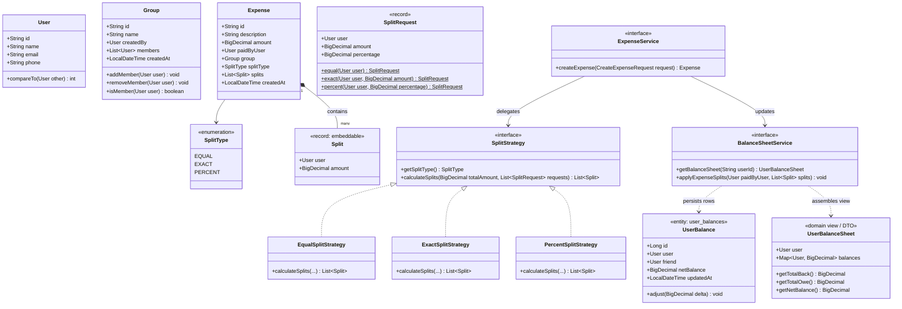
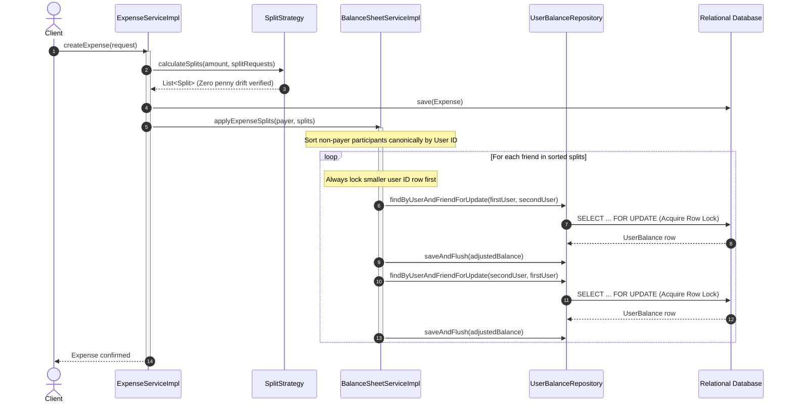

# Splitwise Expense Sharing Engine — Low-Level Design

## 1. Problem Statement & Core Challenges

Expense-sharing applications like **Splitwise** must coordinate financial obligations across millions of users and groups. While recording an expense appears straightforward on the surface, building an enterprise-grade settlement engine involves handling four critical concurrency and mathematical challenges:

```
                  ┌────────────────────────────────────────┐
                  │          Expense Orchestration         │
                  └───────────────────┬────────────────────┘
                                      │
              ┌───────────────────────┼────────────────────────┐
              ▼                       ▼                        ▼
     [ 1. Split Strategy ]   [ 2. Money Precision ]  [ 3. DB Row Concurrency ]
     • Open-Closed Design    • Zero Penny Drift       • Canonical Lock Ordering
     • EQUAL, EXACT, %       • BigDecimal Cent Dist.  • SELECT ... FOR UPDATE
```

1. **The Penny-Rounding Dilemma (Zero Financial Drift):** When $\$100.00$ is split equally among 3 users ($\$33.3333\dots$), simple division yields $\$99.99$, losing 1 cent. The system must allocate remainder cents deterministically so that:
   $$\sum \text{splits} \equiv \text{totalAmount}$$
2. **Circular-Wait Deadlock Avoidance:** When Alice splits an expense with Bob while Bob simultaneously splits an expense with Alice, concurrent database transactions updating `(Alice, Bob)` and `(Bob, Alice)` in opposite directions produce circular waits that crash worker threads.
3. **The Spring AOP Proxy & Uncommitted Insert Trap:** Java `synchronized` methods release object monitors *before* the surrounding Spring `@Transactional` commits. Under concurrent load, multiple threads attempting to create the initial pairwise balance row collide on unique index constraints.
4. **Instant $O(1)$ Balance Lookups:** Rather than computing balances by re-aggregating thousands of past expenses on every screen load, the system maintains a normalized, symmetric `user_balances` projection table for millisecond dashboard reads.

---

## 2. Requirements & Scope Boundaries

### 2.1 Product Requirements (PR)
* **PR-1 (User Management):** Users register with a unique identifier, name, email, and phone.
* **PR-2 (Group Management):** Groups can be created with members added or removed dynamically.
* **PR-3 (Expense Recording):** Expenses can be recorded inside a group or directly between 1-on-1 individuals.
* **PR-4 (Flexible Split Strategies):** Supports `EQUAL`, `EXACT`, and `PERCENT` split types.
* **PR-5 (Real-Time Balance Sheet):** Users can instantly view their total amount owed, total amount to get back, and granular pairwise friend balances.

### 2.2 Functional Requirements (FR)

```java
// Expense Service Contract
Expense createExpense(CreateExpenseRequest request);

// Balance Sheet Service Contract
UserBalanceSheet getBalanceSheet(String userId);
void applyExpenseSplits(User paidByUser, List<Split> splits);
```

### 2.3 Non-Functional Requirements (NFR)
* **Zero Penny Drift:** All monetary arithmetic uses `BigDecimal` scaled to 2 decimal places with remainder cent distribution.
* **Deadlock-Free Concurrency:** Enforces strict **Canonical Lock Ordering** on user IDs (`firstUser < secondUser`).
* **Zero Lost Updates:** Database-level pessimistic locking (`SELECT ... FOR UPDATE`) prevents concurrent update overwrites.
* **Extensibility:** Adding new split strategies (e.g. `SHARE`, `DYNAMIC_TAX`) adheres to the Open-Closed Principle.

---

## 3. Domain Modeling & Architecture

### 3.1 Mermaid Class Diagram



### 3.2 Key Architectural Design Decisions

1. **Separation of Input Intent from Domain Invariant:**
    * Incoming requests specify `SplitRequest` (which may contain raw percentages or null amounts).
    * The `SplitStrategy` transforms these into immutable `Split` records where `amount` is guaranteed to be non-null, valid, and scaled to 2 decimal places.
2. **Symmetric Directed Balance Projection (`user_balances`):**
    * Stores both `(User, Friend, +Amount)` and `(Friend, User, -Amount)`.
    * Enables $O(1)$ single-index dashboard reads (`WHERE user_id = :id`) without scanning the entire expense table.
3. **`User` as a Rich Domain Object & Natural Ordering:**
    * `User` implements `Comparable<User>` comparing `id`. This enables natural sorting for canonical lock acquisition and clean map lookups in `UserBalanceSheet`.

---

## 4. Sequence Flow: Atomic Expense Processing



---

## 5. Core Engine & Concurrency Deep-Dive

### 5.1 The 1-Cent Penny Distribution Algorithm

When dividing $\$100.00$ among 3 users:
1. Base share: $\lfloor 100.00 / 3 \rfloor = \$33.33$.
2. Total accounted: $\$33.33 \times 3 = \$99.99$.
3. Remainder cents: $\$100.00 - \$99.99 = \$0.01$ (1 cent).
4. The engine converts remainder to integer cents (`remainder.movePointRight(2).intValueExact()`) and distributes 1 cent to the first $N$ participants:
    * User 1: $\$33.34$
    * User 2: $\$33.33$
    * User 3: $\$33.33$
    * Sum $\equiv \$100.00$ (Zero drift).

### 5.2 Canonical Database Lock Ordering

To prevent circular-wait deadlocks in concurrent updates:

```java
// BalanceSheetServiceImpl.java
User firstUser = (paidByUser.compareTo(friend) < 0) ? paidByUser : friend;

if (firstUser.equals(paidByUser)) {
    updatePairwiseBalance(paidByUser, friend, amountOwed);
    updatePairwiseBalance(friend, paidByUser, amountOwed.negate());
} else {
    updatePairwiseBalance(friend, paidByUser, amountOwed.negate());
    updatePairwiseBalance(paidByUser, friend, amountOwed);
}
```

Even if Transaction A is Alice $\to$ Bob and Transaction B is Bob $\to$ Alice, **both transactions lock row `(Alice, Bob)` first**. One transaction wins the row lock; the second waits in queue. Deadlock probability is **0%**.

### 5.3 Database Pessimistic Row Locking (`SELECT ... FOR UPDATE`)

In `UserBalanceRepository.java`:
```java
@Lock(LockModeType.PESSIMISTIC_WRITE)
@Query("SELECT ub FROM UserBalance ub WHERE ub.user = :user AND ub.friend = :friend")
Optional<UserBalance> findByUserAndFriendForUpdate(@Param("user") User user, @Param("friend") User friend);
```
Pessimistic locking ensures concurrent balance updates never overwrite each other (eliminating lost updates) without requiring custom application mutexes.

---

## 6. Database Schema Design

```sql
CREATE TABLE users (
    id         VARCHAR(64) PRIMARY KEY,
    name       VARCHAR(255) NOT NULL,
    email      VARCHAR(255) NOT NULL UNIQUE,
    phone      VARCHAR(64) UNIQUE
);

CREATE TABLE user_groups (
    id            VARCHAR(64) PRIMARY KEY,
    name          VARCHAR(255) NOT NULL,
    created_by_id VARCHAR(64) NOT NULL REFERENCES users(id),
    created_at    TIMESTAMP NOT NULL
);

CREATE TABLE user_balances (
    id          BIGINT GENERATED BY DEFAULT AS IDENTITY PRIMARY KEY,
    user_id     VARCHAR(64) NOT NULL REFERENCES users(id),
    friend_id   VARCHAR(64) NOT NULL REFERENCES users(id),
    net_balance NUMERIC(12, 2) NOT NULL DEFAULT 0.00,
    updated_at  TIMESTAMP NOT NULL,
    CONSTRAINT uk_user_friend UNIQUE (user_id, friend_id)
);

CREATE TABLE expenses (
    id               VARCHAR(64) PRIMARY KEY,
    description      VARCHAR(255) NOT NULL,
    amount           NUMERIC(12, 2) NOT NULL,
    paid_by_user_id  VARCHAR(64) NOT NULL REFERENCES users(id),
    group_id         VARCHAR(64) REFERENCES user_groups(id),
    split_type       VARCHAR(32) NOT NULL,
    created_at       TIMESTAMP NOT NULL,
    modified_at      TIMESTAMP NOT NULL
);

CREATE TABLE expense_splits (
    expense_id  VARCHAR(64) NOT NULL REFERENCES expenses(id),
    user_id     VARCHAR(64) NOT NULL REFERENCES users(id),
    amount      NUMERIC(12, 2) NOT NULL
);
```

---

## 7. Empirical Test Suite & Concurrency Verification

The test suite validates both mathematical invariants and multithreaded contention:

### 7.1 Algorithmic & Unit Verification (`SplitStrategyTest`)
* **3-Way Equal Split:** Asserts 1-cent allocation ($\$33.34, \$33.33, \$33.33$) sums to exactly $\$100.00$.
* **6-Way Equal Split:** Asserts 4 remainder cents distributed across first 4 users ($\$16.67 \times 4 + \$16.66 \times 2 = \$100.00$).
* **Exact Split Mismatch:** Validates `IllegalArgumentException` when split sum $\neq$ total amount.
* **Percent Split Mismatch:** Validates `IllegalArgumentException` when percentages $\neq 100.00\%$.

### 7.2 Concurrency Stress Test (`ExpenseServiceIntegrationTest`)
* **Simultaneous Opposing Expenses (20 Threads):**
    * Launches 20 parallel worker threads using `Executors.newFixedThreadPool(20)`.
    * Threads are synchronized using a `CountDownLatch` barrier and fired at the exact same millisecond.
    * Even threads: Alice pays $\$10.00$ split with Bob ($+\$5.00$).
    * Odd threads: Bob pays $\$10.00$ split with Alice ($-\$5.00$).
    * **Result:** All 20 threads complete with **0 deadlocks, 0 aborted transactions**.
    * **Final Assertion:** Alice Net Balance $\equiv \$0.00$, Bob Net Balance $\equiv \$0.00$, and System Invariant $A_{\text{net}} + B_{\text{net}} \equiv 0.00$.

---

## 8. Summary of Engineering Highlights

* **No Over-Engineering:** Simplified `Split` into an immutable Java `record` rather than an empty subclass hierarchy.
* **Pure Database Concurrency:** Handled synchronization at the database level with `PESSIMISTIC_WRITE` and canonical sorting, eliminating brittle JVM-only mutexes.
* **Modern Java 25:** Pure standard Java POJOs, records, and Spring Data JPA with zero annotation processor compiler issues.
