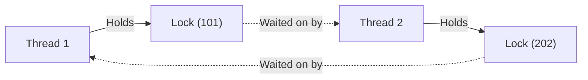

---
tags:
  - concurrency
  - distributed-systems
  - system-design
type:
  - concept
created: 2026-10-17
title: Canonical Lock Ordering
---

# Canonical Lock Ordering 🔒

## 1. What is Canonical Lock Ordering?

**Canonical Lock Ordering** is a foundational concurrency pattern used to eliminate **deadlocks** when multiple threads or transactions must acquire locks on multiple shared resources simultaneously:

> **The Canonical Ordering Invariant:**
> Whenever a thread needs to acquire multiple locks, it must **always acquire them in a universally agreed, strictly sorted order** (e.g., natural ascending order via IDs or keys).

---

## 2. The Problem: The Circular Wait Deadlock

### Real-World Contention Scenario: Alice & Bob
Imagine **Alice** (User ID `101`) and **Bob** (User ID `202`) are splitting bills or transferring funds at the exact same millisecond:

- **Thread 1 (Alice's action):** Alice pays $50 for Bob. It attempts to lock **Alice (`101`)**, then lock **Bob (`202`)**.
- **Thread 2 (Bob's action):** Bob pays $20 for Alice. It attempts to lock **Bob (`202`)**, then lock **Alice (`101`)**.

### The Catastrophic Timeline

```text
Thread 1 (Alice's request)               Thread 2 (Bob's request)
--------------------------               ------------------------
Acquires Lock(101) [Alice] ✅            Acquires Lock(202) [Bob] ✅
         │                                        │
Tries to acquire Lock(202) [Bob]         Tries to acquire Lock(101) [Alice]
   ❌ BLOCKED! (Thread 2 has it)            ❌ BLOCKED! (Thread 1 has it)
         │                                        │
         ▼                                        ▼
   Waiting for Thread 2...                  Waiting for Thread 1...
   ═════════════════════════════════════════════════════════════════
                      💀 DEADLOCK DETECTED!
   Both threads are frozen forever. Thread pool exhausts,
   database connections leak, and the system halts.
   ═════════════════════════════════════════════════════════════════
```

### Coffman Condition: Circular Wait
This failure is caused by **Circular Wait** (one of the 4 Coffman conditions for deadlocks):



---

## 3. The Solution: Total Global Order

By enforcing **Canonical Lock Ordering**, all threads must sort resource identifiers before attempting acquisition:
$$\min(\text{ID}_1, \text{ID}_2) \longrightarrow \max(\text{ID}_1, \text{ID}_2)$$

1. **Thread 1** sorts `[101, 202]` $\to$ Acquires Lock(101), then Lock(202).
2. **Thread 2** sorts `[202, 101]` $\to$ **Also** attempts Lock(101) first, then Lock(202)!

### The Harmonious Timeline

```text
Thread 1 (Alice's request)               Thread 2 (Bob's request)
--------------------------               ------------------------
Acquires Lock(101) ✅                    Tries to acquire Lock(101)...
         │                                  ⏳ BLOCKED (Polite Queue)
Acquires Lock(202) ✅                               │
         │                                          │
Updates ledger safely...                            │
         │                                          │
Releases Lock(202) 🔓                               │
Releases Lock(101) 🔓                               ▼
                                         Acquires Lock(101) ✅
                                         Acquires Lock(202) ✅
                                         Updates ledger safely...
                                         Releases Lock(202) 🔓
                                         Releases Lock(101) 🔓
```

**Result:** Zero deadlock. Both operations succeed deterministically.

---

## 4. Scaling to $N$ Resources (The DAG Guarantee)

When an operation touches $N$ resources (e.g., an expense split among 5 users: `[4, 1, 5, 2, 3]`):

```java
List<Long> canonicalOrder = userIds.stream()
    .distinct()
    .sorted() // -> [1, 2, 3, 4, 5]
    .toList();
```

### Mathematical Proof (Directed Acyclic Graph)
- If all locks are acquired strictly in increasing order ($k_{(1)} < k_{(2)} < \dots < k_{(n)}$), lock dependency edges can only point forward.
- A graph with strictly forward-pointing edges is a **Directed Acyclic Graph (DAG)**.
- Because a DAG contains **zero cycles**, a circular wait deadlock is **mathematically impossible**.

---

## 5. Implementation Patterns (Java 21)

### 5.1 Naive vs Canonical Comparison

#### ❌ Naive (Deadlock-Prone)
```java
public void transfer(Account from, Account to, BigDecimal amount) {
    // 💥 Deadlock if another thread executes transfer(to, from, amount) simultaneously!
    synchronized (from) {
        synchronized (to) {
            from.debit(amount);
            to.credit(amount);
        }
    }
}
```

#### ✅ Canonical Lock Ordering (Deadlock-Proof)
```java
public void transfer(Account from, Account to, BigDecimal amount) {
    Account firstLock = from.getId().compareTo(to.getId()) < 0 ? from : to;
    Account secondLock = from.getId().compareTo(to.getId()) < 0 ? to : from;

    // 🔒 Uniform acquisition order eliminates circular wait
    synchronized (firstLock) {
        synchronized (secondLock) {
            from.debit(amount);
            to.credit(amount);
        }
    }
}
```

### 5.2 Composite Keys with `Comparable`
For complex domains (e.g. cinema ticketing with `showId` and `seatId`), implement `Comparable`:

```java
public record ShowSeatKey(Long showId, Long seatId) implements Comparable<ShowSeatKey> {
    @Override
    public int compareTo(ShowSeatKey other) {
        int cmp = this.showId.compareTo(other.showId);
        return cmp != 0 ? cmp : this.seatId.compareTo(other.seatId);
    }
}

// Usage:
List<ShowSeatKey> sortedKeys = keys.stream().sorted().toList();
for (ShowSeatKey key : sortedKeys) {
    locks.get(key).lock();
}
```

### 5.3 All-or-Nothing Acquisition (Fail-Fast)
To prevent lock starvation when using timed locks:
1. Attempt non-blocking `tryLock(timeout)`.
2. If any lock in the sorted batch cannot be acquired, immediately release all already-acquired locks in reverse order and fail-fast or retry with jittered exponential backoff.

---

## 6. Real-World Applications Across the Stack

| Layer | Real-World Application | How Canonical Ordering is Applied |
| :--- | :--- | :--- |
| **Application (JVM)** | Splitwise / [[BookMyShow Cinema Ticketing Engine]] | Sort participant user IDs or seat keys `(showId, seatId)` before synchronizing. |
| **Relational Database** | PostgreSQL / MySQL Row Locks | Always append `ORDER BY id ASC` to `SELECT ... FOR UPDATE` multi-row statements. |
| **Distributed Cache** | Redis Redlock / Lua Scripts | Sort Redis keys alphabetically/numerically before acquiring multi-key distributed locks. |
| **Financial Ledger** | Double-Entry Accounting | Always lock debit and credit accounts in ascending account-ID order. |

---

## 7. Related Concepts
* [[Two-Phase Reservation Pattern]]
