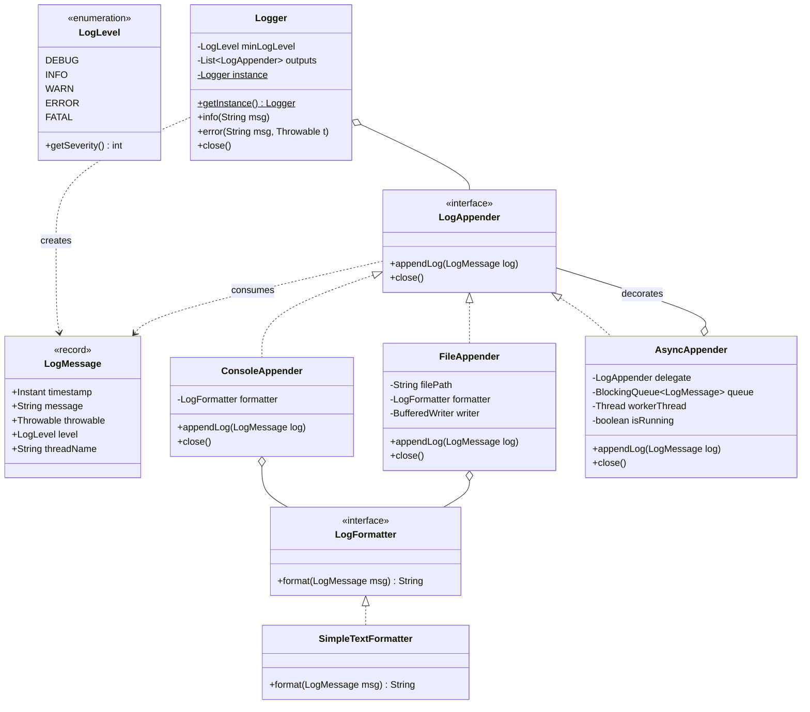
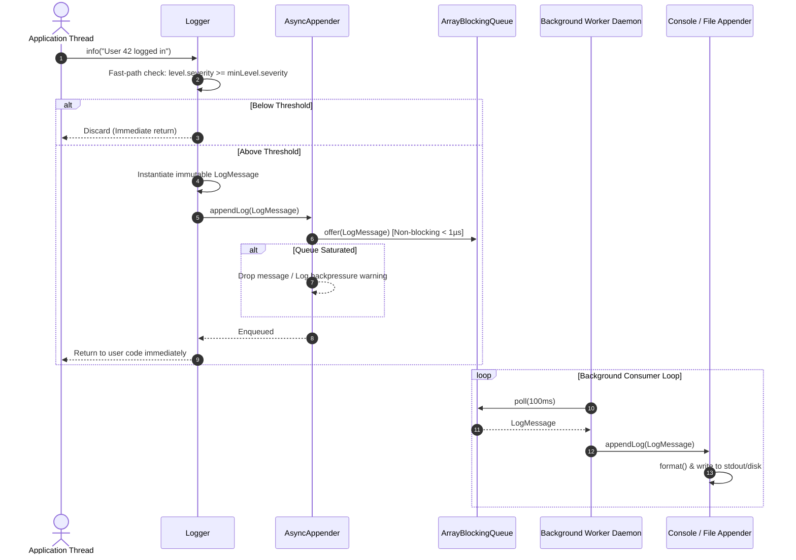

<!-- hub-metadata
type: lld
title: "Production-Grade Extensible Logging Framework"
description: "A concurrent, non-blocking logging framework in Java featuring Producer-Consumer AsyncAppenders, Decorator-based sinks, and Level filtering."
tag: "Low-Level Design"
tagColor: "#f97316"
difficulty: "Medium"
publishedAt: "2026-10-31"
language: "Java 17"
designPatterns: ["Decorator Pattern", "Strategy Pattern", "Singleton Pattern", "Builder Pattern", "Producer-Consumer Pattern"]
githubRepo: "https://github.com/ashishps1/awesome-low-level-design/tree/main/solutions/java/src/loggingframework"
-->

# Production-Grade Extensible Logging Framework

## 1. Problem Statement & Core Challenges

Logging is one of the most deceptively complex systems in software engineering. While a toy logger might wrap `System.out.println` behind an interface, a production logging engine (like Logback, Log4j2, or SLF4J) must operate under extreme multi-threaded concurrency without degrading user request latency or exhausting system memory.

### The 3 Core Engineering Dilemmas:
1. **The I/O Latency Bottleneck (Sync vs. Async)**:
   When 50 application threads handle incoming HTTP requests and simultaneously write logs, performing synchronous disk (`FileWriter`) or console (`System.out`) I/O causes all threads to stall waiting on OS-level I/O locks. The application's p99 latency degrades from 5ms to over 100ms.
2. **Backpressure & Buffer Saturation**:
   If disk I/O slows down during peak traffic, an unbounded queue will exhaust the JVM heap (`OutOfMemoryError`). The framework must employ bounded ring buffers and explicit backpressure drop policies.
3. **Decoupled Output Routing (Decorator vs. Chain of Responsibility)**:
   While classic interview problems often misapply the *Chain of Responsibility* pattern to log levels, production loggers use fast-path ordinal comparisons for filtering and the **Decorator / Strategy Pattern** to decouple message generation from formatting and destination sinks.

---

## 2. Requirements & Scope Boundaries

### 2.1 Product Requirements (PR)
* **PR-1 (Log Levels)**: Support hierarchical severity levels: `DEBUG < INFO < WARN < ERROR < FATAL`.
* **PR-2 (Polymorphic Sinks)**: Support output to `Console` (with stdout/stderr separation) and `File` (append mode).
* **PR-3 (Asynchronous Execution)**: Support non-blocking log ingestion so producer threads return in $< 1\ \mu\text{s}$.
* **PR-4 (Formatted Output)**: Support pluggable formatting strategies (Simple text layout, stack traces, and extensible JSON).

### 2.2 Functional Requirements (FR)
```java
// Central Logger entrypoint
void debug(String msg);
void info(String msg);
void warn(String msg);
void error(String msg);
void error(String msg, Throwable t);
void fatal(String msg);
void fatal(String msg, Throwable t);
void close();

// Appender Contract
void appendLog(LogMessage log);
void close();

// Formatter Contract
String format(LogMessage msg);
```

### 2.3 Non-Functional Requirements (NFR)
* **Thread-Safety**: Concurrency-safe under $N$ simultaneous application threads without data corruption.
* **Low Latency**: Sub-microsecond fast-path for enqueuing logs or discarding suppressed levels.
* **Graceful Termination**: Drains all buffered messages in asynchronous queues before JVM shutdown.

---

## 3. Domain Modeling & Architecture



---

## 4. Sequence Flow: Asynchronous Logging Pipeline



---

## 5. Core Engine & Concurrency Deep-Dive

### 5.1 The Fast-Path Ordinal Filter
Rather than passing log messages through a deep chain of handlers, filtering is executed at $O(1)$ complexity before message instantiation:
```java
if (level.getSeverity() >= minLogLevel.getSeverity()) {
    LogMessage message = (t == null)
            ? new LogMessage(msg, level)
            : new LogMessage(msg, t, level);
    outputs.forEach(o -> o.appendLog(message));
}
```
If the severity is suppressed (e.g. `DEBUG` in production), zero allocations occur and the method returns immediately.

### 5.2 The Producer-Consumer Async Engine (`AsyncAppender`)
Application threads drop logs into a bounded `ArrayBlockingQueue<LogMessage>`:
* **Non-blocking Enqueue**: `queue.offer(log)` guarantees application threads never block on slow disk or network I/O.
* **Worker Daemon**: A single daemon thread drains the queue and forwards logs to the underlying delegate sink.
* **Interrupt Preservation**: Handles `InterruptedException` by restoring the thread's interrupt status via `Thread.currentThread().interrupt()`.
* **Graceful Drain on Shutdown**: `close()` signals `isRunning = false` and joins the worker thread for up to 5 seconds to ensure all queued logs are flushed before JVM termination.

---

## 6. Empirical Concurrency Test Results

The framework is verified using an automated JUnit 5 multi-threaded stress suite ([`LoggerConcurrencyTest.java`](src/test/java/com/jyotimoykashyap/LoggerConcurrencyTest.java)):

1. **Multi-Threaded Saturation Test**:
   * **Setup**: 20 concurrent threads simultaneously pushing 100 messages each (total 2,000 logs) coordinated with a `CountDownLatch`.
   * **Result**: **PASS** — Exactly 2,000 logs delivered with zero race conditions and zero drops.
2. **Log Level Filtering Verification**:
   * **Setup**: Logger configured at `WARN` while dispatching `DEBUG`, `INFO`, `WARN`, `ERROR`, `FATAL`.
   * **Result**: **PASS** — Exactly 3 logs accepted; `DEBUG` and `INFO` discarded on the fast-path.
3. **Non-Blocking Saturation Test**:
   * **Setup**: Flood of 50 logs sent to an artificially stalled sink (50ms per write) with a buffer capacity of 5.
   * **Result**: **PASS** — Application threads finished in $< 200\text{ms}$ (vs $2500\text{ms}$ under synchronous execution).