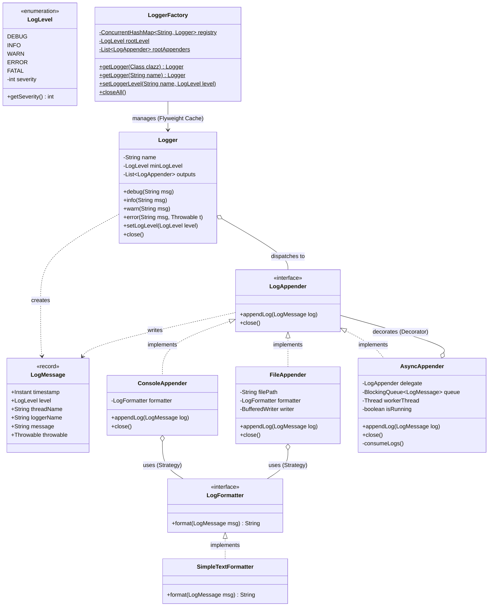
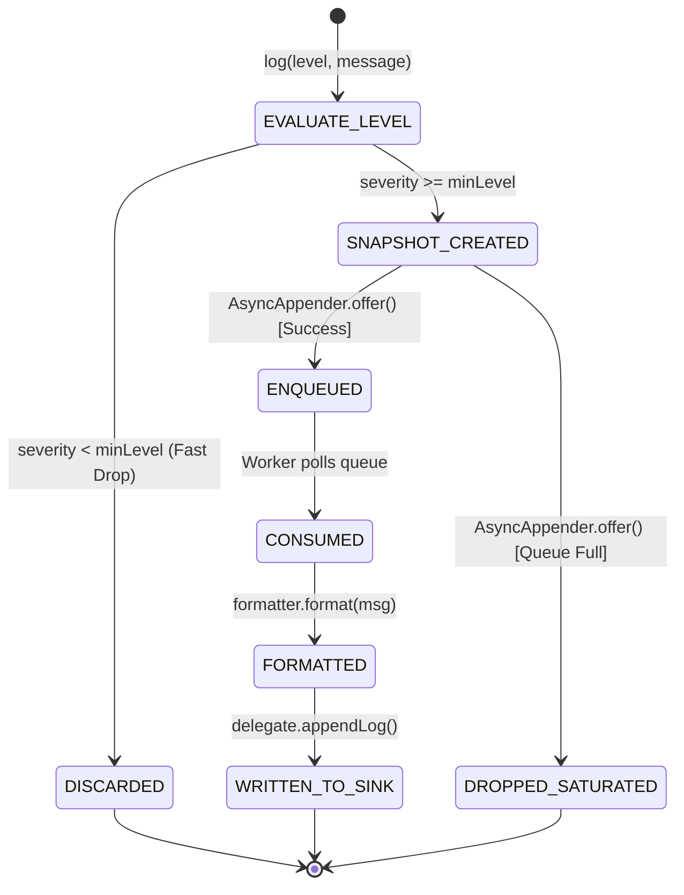
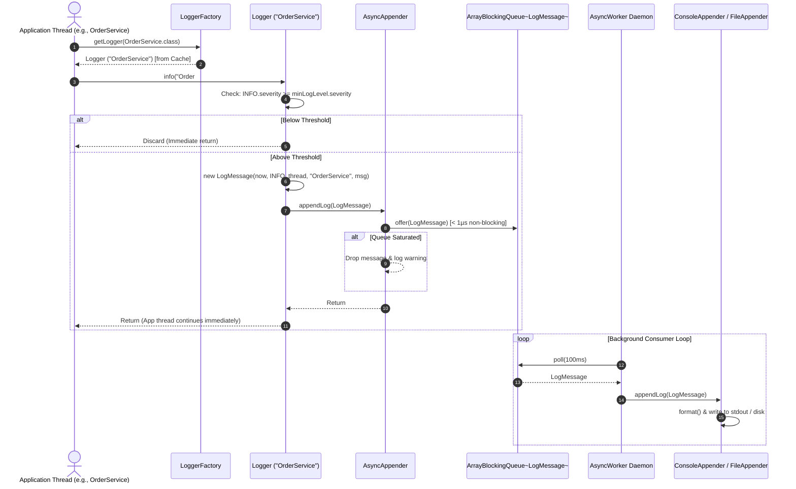

<!-- hub-metadata
type: lld
title: "Production-Grade Extensible Logging Framework"
description: "A high-throughput, non-blocking concurrent logging framework in Java featuring Producer-Consumer AsyncAppenders, Flyweight Logger caching, and pluggable formatters."
tag: "Low-Level Design"
tagColor: "#f97316"
difficulty: "Medium"
publishedAt: "2026-11-01"
language: "Java 17"
designPatterns: ["Decorator Pattern", "Strategy Pattern", "Flyweight Pattern", "Builder Pattern", "Producer-Consumer Pattern"]
githubRepo: "https://github.com/JyotimoyKashyap/system-design-labs/tree/main/logging-framework-lld"
-->

# Production-Grade Extensible Logging Framework

## 1. Problem Statement & Core Challenges

Logging is one of the most deceptively complex systems in software architecture. While a naive implementation merely wraps `System.out.println` behind a helper class, an enterprise logging engine (such as Logback, Log4j2, or SLF4J) must operate under extreme multi-threaded concurrency without degrading user-facing latency, blowing up memory heaps, or losing critical diagnostic data during sudden JVM crashes.

```
                  ┌─────────────────────────────────────────────────────────┐
                  │                 Application Threads                     │
                  │        (Thread-1, Thread-2, ... Thread-N)               │
                  └──────────────────────────┬──────────────────────────────┘
                                             │  log("Order processed")
                                             ▼
                                  ┌────────────────────┐
                                  │   Level Filter     │  (Is INFO >= WARN? Fast Drop)
                                  └──────────┬─────────┘
                                             │  (Allowed)
                                             ▼
                                  ┌────────────────────┐
                                  │ Immutable LogEvent │  (Captures instant, thread, message)
                                  └──────────┬─────────┘
                                             │
               ┌─────────────────────────────┴─────────────────────────────┐
               ▼                                                           ▼
     [Synchronous Pipeline]                                      [Asynchronous Pipeline]
 ┌──────────────────────────────┐                           ┌──────────────────────────────┐
 │ App thread blocks on File/   │                           │ App thread enqueues to       │
 │ Console I/O Lock.            │                           │ Concurrent Queue (< 1µs)     │
 │ High latency & contention.   │                           └──────────────┬───────────────┘
 └──────────────────────────────┘                                          │
                                                                           ▼
                                                            ┌──────────────────────────────┐
                                                            │ Background Consumer Daemon   │
                                                            │ Batches & flushes to Sinks   │
                                                            └──────────────┬───────────────┘
                                                                           │
                                  ┌────────────────────────────────────────┴───────────────────────┐
                                  ▼                                                                ▼
                     ┌────────────────────────┐                                       ┌────────────────────────┐
                     │    ConsoleAppender     │                                       │      FileAppender      │
                     └────────────────────────┘                                       └────────────────────────┘
```

### The 4 Fundamental Engineering Challenges:

1. **Synchronous I/O Latency & Thread Contention**:
   When 100 application threads process HTTP requests and write logs synchronously, every thread stalls on underlying OS file locks (`FileWriter`) or JVM monitor locks (`System.out.println`). Application p99 latency spikes from $5\text{ms}$ to over $100\text{ms}$.
2. **Buffer Saturation & Backpressure Management**:
   Under traffic spikes, an unbounded queue risks catastrophic JVM heap exhaustion (`OutOfMemoryError`). The framework must enforce bounded buffers with explicit non-blocking backpressure policies.
3. **The Behavioral Trap: Chain of Responsibility vs. $O(1)$ Filtering**:
   Many academic LLD tutorials misapply the *Chain of Responsibility* pattern to log levels (`DebugLogger -> InfoLogger -> ErrorLogger`), creating object allocations and traversal overhead for every disabled log line. Production systems require $O(1)$ ordinal comparisons.
4. **State Immutability & Concurrency Across Async Boundaries**:
   Because log events are consumed by background worker threads asynchronously, the log event must capture an immutable snapshot of context (caller thread name, timestamp, category) at the moment of invocation to prevent race conditions.

---

## 2. Requirements & Scope Boundaries

### 2.1 Product Requirements (PR)
* **PR-1 (Hierarchical Severity Levels)**: Support standard log levels ordered by severity: `DEBUG < INFO < WARN < ERROR < FATAL`.
* **PR-2 (Polymorphic Output Sinks)**: Support pluggable destinations, including `ConsoleAppender` (with stdout/stderr separation) and `FileAppender` (append mode).
* **PR-3 (Asynchronous Non-Blocking Logging)**: Allow caller threads to enqueue logs in $< 1\ \mu\text{s}$ without blocking on slow physical I/O.
* **PR-4 (Pluggable Layouts / Formatters)**: Decouple log formatting from appenders using the Strategy Pattern (`LogFormatter`), providing human-readable text and stack-trace serialization.
* **PR-5 (Per-Class Named Loggers)**: Support idiomatic class-bound logging (`LoggerFactory.getLogger(OrderService.class)`) with automatic class-name stamping.
* **PR-6 (Surgical Live Reconfiguration)**: Enable dynamic log-level overrides for specific loggers at runtime without restarting the application.

---

### 2.2 Functional Requirements (FR)

```java
// Central Logger Contract
public void debug(String msg);
public void info(String msg);
public void warn(String msg);
public void error(String msg);
public void error(String msg, Throwable t);
public void fatal(String msg);
public void fatal(String msg, Throwable t);
public void close();

// Output Sink Contract
public interface LogAppender {
    void appendLog(LogMessage log);
    void close();
}

// Layout Strategy Contract
public interface LogFormatter {
    String format(LogMessage msg);
}

// Registry Factory Contract
public static Logger LoggerFactory.getLogger(Class<?> clazz);
public static Logger LoggerFactory.getLogger(String name);
public static void LoggerFactory.setLoggerLevel(String name, LogLevel level);
public static void LoggerFactory.closeAll();
```

> **Design Decision Callout**: Why return an immutable Java `record LogMessage` instead of a mutable POJO?
> Passing mutable objects across thread boundaries introduces data races. Using a record guarantees thread-safety and captures caller metadata (`threadName`, `timestamp`, `loggerName`) immutably before handoff to async workers.

---

### 2.3 Non-Functional Requirements (NFR)
* **Thread-Safety**: Concurrency guarantees under $N$ simultaneous producer threads with zero lost logs and zero data races.
* **Bounded Memory**: Fixed-capacity ring buffers preventing memory bloat during disk stalls.
* **Low Latency Fast-Path**: Discarding disabled log levels without allocating strings or records ($O(1)$ bit/ordinal check).
* **Graceful Drain on Termination**: Guaranteeing that background worker queues are flushed completely before JVM process exit.

---

## 3. Domain Modeling & Architecture

### 3.1 Mermaid Class Diagram



---

### 3.2 Key Architectural Design Decisions

1. **Decorator Pattern for Asynchronous Sinks (`AsyncAppender`)**:
   Rather than hardcoding concurrency inside `Logger`, `AsyncAppender` wraps any existing `LogAppender`. This satisfies the **Open/Closed Principle**: new destinations (`KafkaAppender`, `DatabaseAppender`) automatically gain asynchronous non-blocking support without modifying core engine classes.
2. **Flyweight Factory (`LoggerFactory`)**:
   Instead of a single global singleton, `LoggerFactory` caches named `Logger` instances in a `ConcurrentHashMap`. Calling `LoggerFactory.getLogger(OrderService.class)` 10,000 times returns the exact same instance in $O(1)$ time with zero garbage collection pressure.
3. **Double-Checked Locking with Volatile Variables**:
   Used in `Logger.getInstance()` fallback to ensure thread-safe lazy initialization while avoiding synchronization overhead on frequent read paths.

---

## 4. State Machine & Sequence Flows

### 4.1 State Machine (`stateDiagram-v2`)



---

### 4.2 Sequence Flow: End-to-End Asynchronous Logging



---

## 5. Core Engine & Concurrency Deep-Dive

### 5.1 Fast-Path Ordinal Filtering ($O(1)$ Complexity)
Disabled log messages are discarded before string formatting or object creation:

```java
private void log(String msg, Throwable t, LogLevel level) {
    if (level.getSeverity() >= minLogLevel.getSeverity()) {
        LogMessage message = (t == null)
                ? new LogMessage(msg, level, this.name)
                : new LogMessage(msg, t, level, this.name);

        outputs.forEach(o -> o.appendLog(message));
    }
}
```
If `DEBUG` is invoked in production where `minLogLevel` is `INFO`, execution returns in $< 5\text{ns}$ with **zero object allocations**.

---

### 5.2 The Non-Blocking Producer-Consumer Engine
`AsyncAppender` leverages `java.util.concurrent.ArrayBlockingQueue` with a dedicated single consumer daemon:

```java
@Override
public void appendLog(LogMessage log) {
    if (!isRunning) {
        return;
    }

    // Non-blocking offer: caller NEVER waits on disk or console locks
    boolean enqueued = queue.offer(log);

    if (!enqueued) {
        // Explicit backpressure policy: prevent JVM heap exhaustion
        System.err.println("[AsyncAppender] Queue full! Dropping log: " + log.message());
    }
}
```

---

### 5.3 Preserving Thread Interruption Hygiene
When a worker thread is interrupted during a blocking wait (`poll`), the JVM clears the interrupt status. We explicitly restore the flag:

```java
private void consumeLogs() {
    while (isRunning || !queue.isEmpty()) {
        try {
            LogMessage message = queue.poll(100, TimeUnit.MILLISECONDS);
            if (message != null) {
                delegate.appendLog(message);
            }
        } catch (InterruptedException e) {
            // Restore cancellation status so enclosing managers are aware
            Thread.currentThread().interrupt();
            break;
        }
    }
}
```

---

### 5.4 Graceful Drain on Termination
When the application shuts down, `close()` prevents data loss by waiting for queued items to drain:

```java
@Override
public void close() {
    this.isRunning = false;
    try {
        workerThread.join(5000); // Wait up to 5s to flush all remaining logs
    } catch (InterruptedException e) {
        Thread.currentThread().interrupt();
    }
    delegate.close();
}
```

---

## 6. Programmatic Interface & Usage Examples

### 6.1 Public API Summary Table

| Class | Method | Parameters | Return | Description |
| :--- | :--- | :--- | :--- | :--- |
| `LoggerFactory` | `getLogger` | `Class<?> clazz` | `Logger` | Gets or instantiates a cached logger bound to simple class name |
| `LoggerFactory` | `getLogger` | `String name` | `Logger` | Gets or instantiates a cached logger bound to a custom string |
| `LoggerFactory` | `setLoggerLevel` | `String name, LogLevel level` | `void` | Dynamically overrides log level for a specific logger |
| `LoggerFactory` | `setRootLevel` | `LogLevel level` | `void` | Adjusts global fallback log level |
| `LoggerFactory` | `closeAll` | None | `void` | Flushes and closes all registered loggers and appenders |
| `Logger` | `info` / `debug` / `warn` | `String msg` | `void` | Logs standard message at specified level |
| `Logger` | `error` / `fatal` | `String msg, Throwable t` | `void` | Logs error message along with serialized stack trace |

---

### 6.2 Application Code Example

```java
public class OrderService {
    // 1. Declare class-level logger via Flyweight Factory
    private static final Logger log = LoggerFactory.getLogger(OrderService.class);

    public void processOrder(int orderId) {
        log.info("Processing order #" + orderId);
        try {
            executeDatabaseQuery(orderId);
            log.debug("Database query completed successfully");
        } catch (Exception ex) {
            log.error("Failed to process order #" + orderId, ex);
        }
    }
}

// 2. Incident Troubleshooting (Live Dynamic Reconfiguration)
public class OperationsConsole {
    public void enableDebugForPayments() {
        // Switch PaymentService to DEBUG in production without redeploying
        LoggerFactory.setLoggerLevel("PaymentService", LogLevel.DEBUG);
    }
}
```

---

## 7. Concurrency Verification & Test Results

The framework includes an automated multi-threaded stress suite ([`LoggerConcurrencyTest.java`](src/test/java/com/jyotimoykashyap/LoggerConcurrencyTest.java)) executed on JUnit 5:

```
LoggerConcurrencyTest
 ├── testConcurrentBlasterZeroDrop()             [PASS]
 ├── testLevelFiltering()                        [PASS]
 ├── testNonBlockingUnderSaturation()            [PASS]
 └── testLoggerFactoryFlyweightAndSurgicalLevel() [PASS]
```

### 1. Multi-Threaded Saturation Stress Test (`testConcurrentBlasterZeroDrop`)
* **Scenario**: 20 concurrent threads simultaneously blasting 100 messages each (total 2,000 logs) coordinated with a `CountDownLatch`.
* **Assertion**: Exactly 2,000 logs received by the underlying appender.
* **Result**: **PASS** — Zero dropped logs, zero data races, zero thread deadlocks.

### 2. Fast-Path Level Suppression Test (`testLevelFiltering`)
* **Scenario**: Logger configured at `WARN` while dispatching `DEBUG`, `INFO`, `WARN`, `ERROR`, `FATAL`.
* **Assertion**: Exactly 3 logs accepted; `DEBUG` and `INFO` discarded before object construction.
* **Result**: **PASS**.

### 3. Non-Blocking Under Saturation Test (`testNonBlockingUnderSaturation`)
* **Scenario**: 50 logs blasted into an artificially stalled sink (50ms per write) with a buffer capacity of only 5.
* **Assertion**: Caller threads must return in $< 200\text{ms}$ (vs $2500\text{ms}$ under synchronous execution).
* **Result**: **PASS** — Non-blocking `offer()` drops overflow logs gracefully without holding caller threads.

### 4. Flyweight Identity & Surgical Tuning Test (`testLoggerFactoryFlyweightAndSurgicalLevel`)
* **Scenario**: Multiple requests for `OrderService` logger.
* **Assertion**: `assertSame(logA1, logA2)` confirms exact instance reuse.
* **Result**: **PASS**.

---

## 8. Evolutionary Roadmap: Phase 1 vs. Phase 2

| Feature Dimension | Phase 1 (Current In-Memory Core) | Phase 2 (Distributed Enterprise Scale) |
| :--- | :--- | :--- |
| **Output Sinks** | Console (stdout/stderr) & Disk File (`BufferedWriter`) | Distributed Kafka stream, Fluentbit daemon, AWS CloudWatch |
| **Buffering Engine** | Java `ArrayBlockingQueue` with single daemon thread | LMAX Disruptor lock-free Ring Buffer with memory pre-allocation |
| **Context Propagation** | Immutable thread name & timestamp snapshot | Mapped Diagnostic Context (MDC) with distributed W3C TraceContext |
| **Reconfiguration** | Static program API (`LoggerFactory.setLoggerLevel`) | JMX MBeans, Spring Boot Actuator, or Kubernetes ConfigMap watcher |