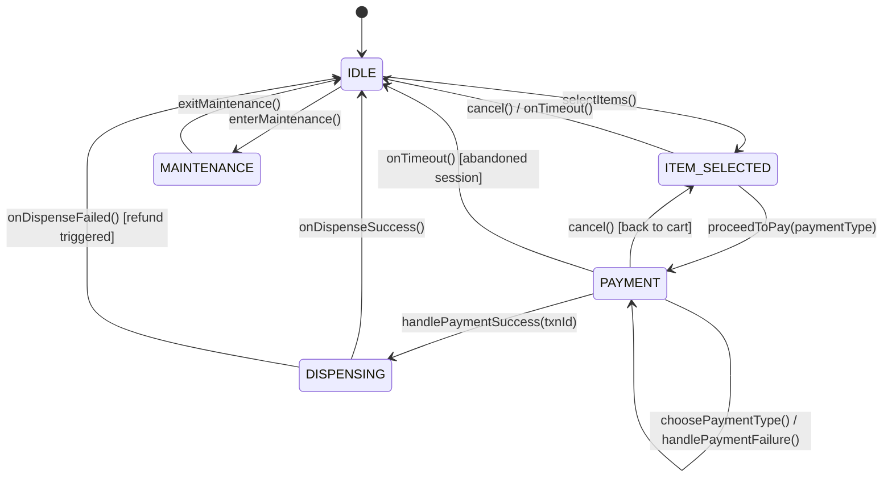
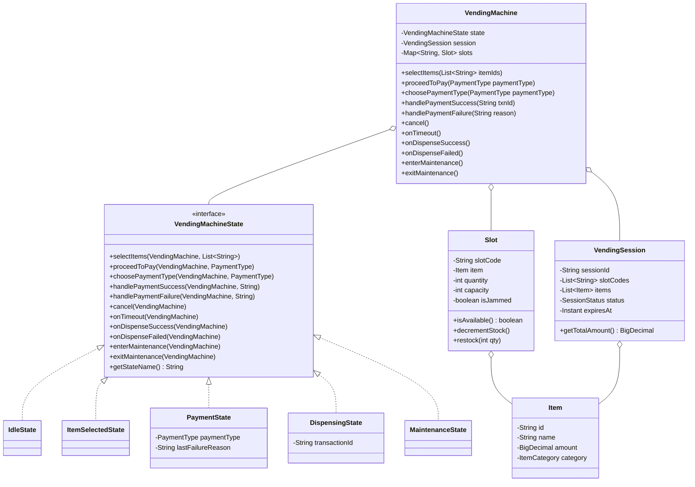

<!-- hub-metadata
type: lld
title: "Vending Machine Low-Level Design"
description: "A streamlined, production-grade Low-Level Design of an automated Vending Machine in Java 21, featuring State Pattern, inventory slots, and resilient payment workflows."
tag: "Low-Level Design"
tagColor: "#10b981"
difficulty: "Medium"
publishedAt: "2026-10-30"
language: "Java 21"
designPatterns: ["State Pattern", "Strategy Pattern"]
-->

# Vending Machine System — Low-Level Design (LLD)

## 1. Problem Statement & Overview
A modern smart vending machine allows customers to select items from physical slots, choose a payment method (UPI, Card, Cash), and receive dispensed products. The system must maintain consistent internal states, gracefully handle payment timeouts and failures, and allow operators to service slots under maintenance mode.

---

## 2. Requirements Analysis

### Functional Requirements (FR)
1. **Catalog & Selection**: Customers can view available items and select one or multiple items to initiate a vending session.
2. **Payment Processing**:
   - Customer can choose a payment method (UPI, Card).
   - System handles asynchronous or synchronous payment outcomes (`PaymentSuccess`, `PaymentFailure`).
   - If payment fails, customer can switch payment methods or retry without losing their active selection.
3. **Cancellation & Expiration**:
   - Customer can cancel the session prior to payment success.
   - Sessions expire if inactive beyond a configured timeout.
4. **Physical Dispensing**:
   - Upon successful payment verification, the machine triggers physical dispensing.
   - On dispensing failure (e.g., hardware jam), the system initiates an automated refund.
5. **Maintenance**:
   - Technicians can toggle the machine into `MAINTENANCE` mode to restock inventory or perform diagnostics.

### Non-Functional Requirements (NFR)
1. **Thread-Safety & Correctness**: Slot inventory mutations and session transitions must be thread-safe.
2. **Deterministic State Transitions**: Invalid actions (e.g. attempting to dispense in `IDLE` state) must throw explicit domain exceptions.

---

## 3. Finite State Machine (FSM)

The system is governed by a 5-state lifecycle:



### State Definitions
| State | Allowed Transitions | Invariant / Responsibility |
|---|---|---|
| `IDLE` | `selectItems()`, `enterMaintenance()` | Machine is unoccupied and ready for customers. |
| `ITEM_SELECTED` | `proceedToPay()`, `cancel()`, `onTimeout()` | Items held in active session; awaiting payment commitment. |
| `PAYMENT` | `choosePaymentType()`, `handlePaymentSuccess()`, `handlePaymentFailure()`, `cancel()`, `onTimeout()` | Awaiting payment gateway verification. Allows retry on failure. |
| `DISPENSING` | `onDispenseSuccess()`, `onDispenseFailed()` | Hardware actuator running; releases inventory or initiates refund. |
| `MAINTENANCE` | `exitMaintenance()` | Locked out from public customer transactions. |

---

## 4. Class Diagram



---

## 5. Sequence Diagram: Payment Failure & Retry Flow

```mermaid
sequenceDiagram
    autonumber
    actor Customer
    participant VM as VendingMachine
    participant State as PaymentState
    participant Dispense as DispensingState

    Customer->>VM: selectItems(["ITEM-1"])
    VM-->>Customer: State: ITEM_SELECTED (Cart Total: $2.50)

    Customer->>VM: proceedToPay(UPI)
    VM-->>Customer: State: PAYMENT (Method: UPI)

    Note over VM,State: Gateway reports transaction failure
    VM->>State: handlePaymentFailure("UPI_TIMEOUT")
    State-->>VM: Remains in PAYMENT (Stores lastFailureReason)
    VM-->>Customer: "UPI failed. Please retry or choose another method."

    Customer->>VM: choosePaymentType(CARD)
    VM->>State: choosePaymentType(CARD)

    Note over VM,State: Customer swipes card; Gateway confirms
    VM->>State: handlePaymentSuccess("TXN-CARD-99")
    State->>VM: setState(new DispensingState("TXN-CARD-99"))
    VM-->>Customer: State: DISPENSING

    VM->>Dispense: onDispenseSuccess()
    Dispense->>VM: clearSession() & setState(new IdleState())
    VM-->>Customer: State: IDLE (Product dispensed)
```

---

## 6. Empirical Verification & Test Suite

The test suite in [`VendingMachineTest.java`](file:///Users/jyotimoykashyap/Developer/personal-lab/vending-machine-lld/src/test/java/com/jyotimoykashyap/VendingMachineTest.java) covers:
- **Happy Path**: Full cycle through item selection, payment confirmation, and product dispensing.
- **Payment Failure & Method Switching**: Retrying a failed UPI attempt with a credit card without losing active session state.
- **Cancellation**: Graceful abort in both `ITEM_SELECTED` and `PAYMENT` states.
- **Maintenance Locks**: Verification that customer requests are rejected during maintenance mode.
- **Illegal Transition Guards**: Assertion that operations out-of-order throw `IllegalStateException`.
